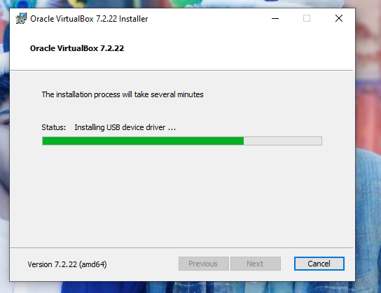
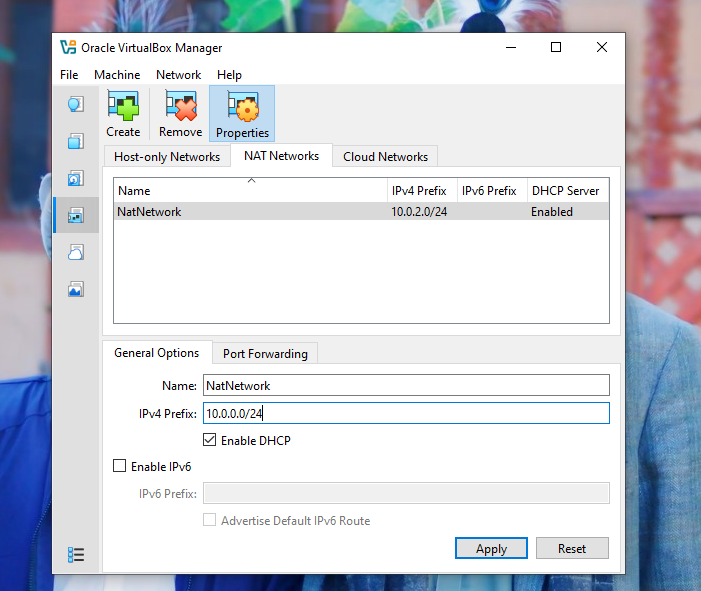
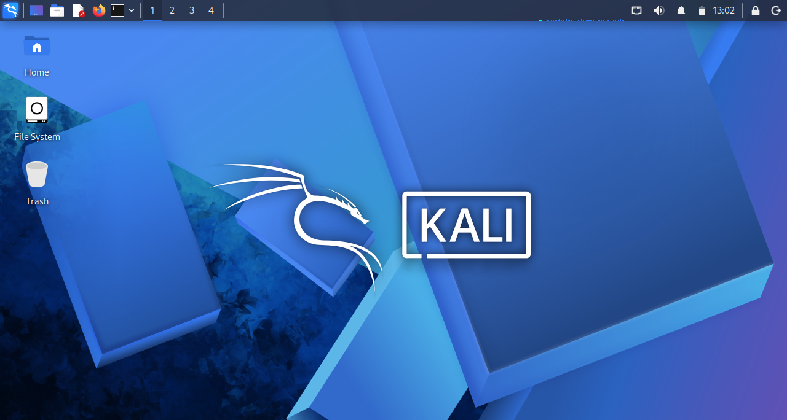
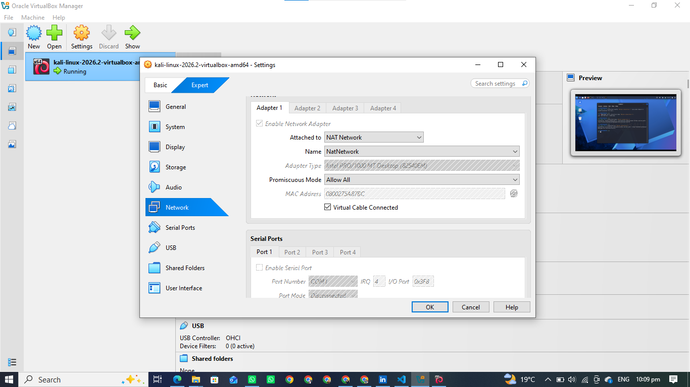
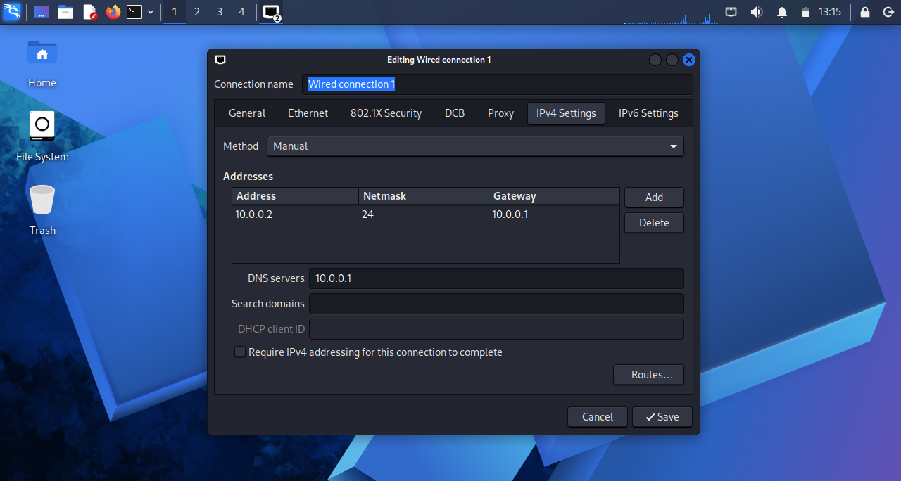
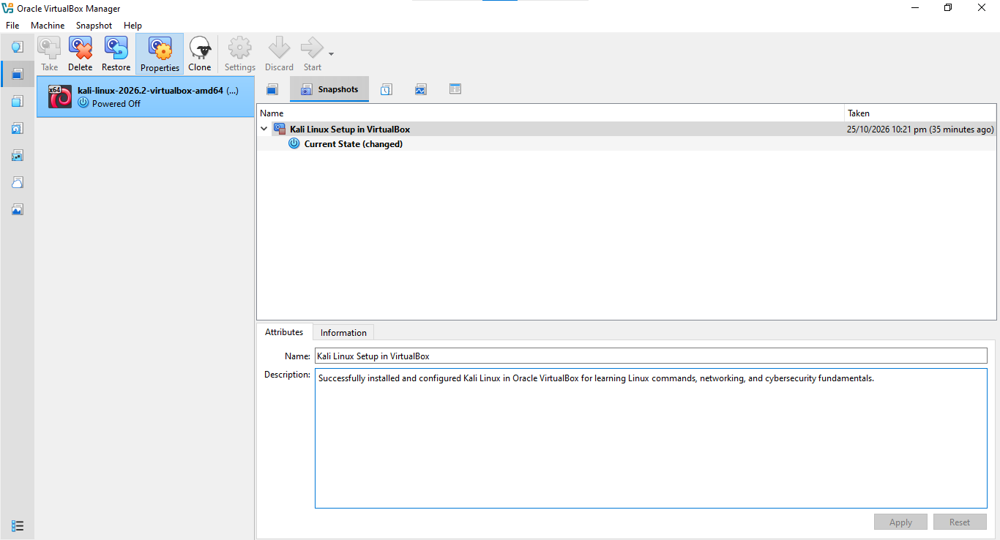

# Cybersecurity Lab Setup Using VirtualBox and Kali Linux

##  Project Introduction

In this project I created a basic cybersecurity lab using Oracle VirtualBox and Kali Linux. The main purpose was to learn how to install the required software, set up a virtual machine, and configure its network.

This is my first step toward learning cybersecurity and penetration testing in a safe environment.

##  Project Goals

- Install 7-Zip and VirtualBox.
- Download and set up Kali Linux.
- Configure the network in VirtualBox.
- Check the internet connection in Kali Linux.
- Create a snapshot to save the current VM state.
- Take screenshots of the setup process.

## Tools Used

| Tool | Purpose |
|---|---|
| 7-Zip | To extract the downloaded files |
| Oracle VirtualBox | To run a virtual machine |
| Kali Linux | To learn Linux and cybersecurity |
| Windows 10 | My main operating system |

##  Installation and Setup

### Step 1: Install 7-Zip

First, I downloaded and installed 7-Zip on my Windows computer. I used it to extract the Kali Linux files.

### Step 2: Install VirtualBox

After installing 7-Zip, I downloaded Oracle VirtualBox and installed it on my computer. VirtualBox allows me to run another operating system without replacing Windows.

<!-- Add your VirtualBox screenshot here -->

### Step 3: Create the NAT Network
I opened VirtualBox and went to the Network settings. I created a NAT Network to allow virtual machines to communicate and access the internet.

**Steps:**
1. Open VirtualBox.
2. Go to Tools → Network.
3. Open the NAT Networks tab.
4. Click Create and configure the network.
5. Save the settings.
   

### Step 4: Download Kali Linux

Next, I downloaded the Kali Linux virtual machine package from the official website. I extracted the files when required and opened the virtual machine in VirtualBox.

<!-- Add your Kali Linux download or import screenshot here -->

### Step 5: Configure the Virtual Machine

I checked the virtual machine settings before starting Kali Linux. I assigned memory to the VM and selected the appropriate network option in VirtualBox.

The settings used on my computer should be documented with screenshots.

<!-- Add your VM settings screenshot here -->

### Step 6: Configure the Network

After starting Kali Linux, I checked the network connection and IP address. I also learned how the IP address, gateway, and DNS help a computer communicate with other devices and access the internet.

<!-- Add your actual terminal screenshot here -->

### Step 7: Create a Snapshot

After completing the initial setup, I created a snapshot of the virtual machine. A snapshot saves the VM's current state so I can return to it if something goes wrong during future practice.

<!-- Add your snapshot screenshot here -->

## Testing the Internet Connection

I tested the internet connection in Kali Linux by opening Google in the web browser. Google opened successfully, which showed that the internet was working.

## 📚 What I Learned

During this project, I learned:

- How to install software on Windows.
- How to use VirtualBox.
- How to set up Kali Linux as a virtual machine.
- How to check IP addresses and network connectivity.
- How to create a VM snapshot.
- How to save screenshots and document my work.

## 🔒 Safe Use

I will use this lab for learning and practice only. I will perform security testing only on my own systems or on systems for which I have permission.

## 🚀 Future Plans

In the future, I plan to:

- Learn more Kali Linux commands.
- Practice basic networking.
- Learn how to use Nmap.
- Add another virtual machine for testing.
- Explore basic cybersecurity tools.

## 👨‍🎓 About This Project

**Project:** Cybersecurity Lab Setup  
**Program:** Cybersecurity Internship  
**Week:** 01  
**Level:** Beginner

This project helped me understand the basic steps required to create a virtual lab for cybersecurity learning.

